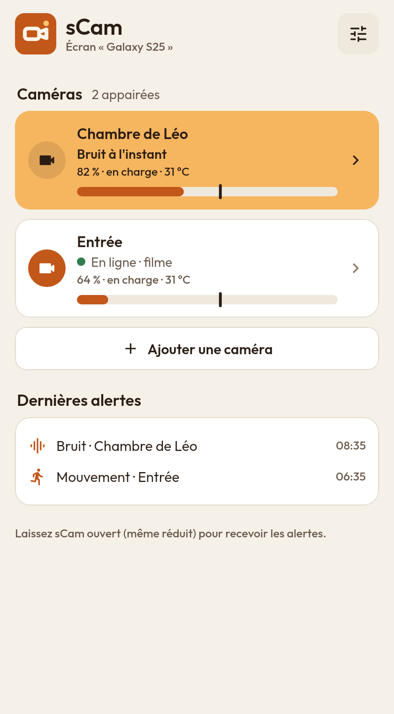
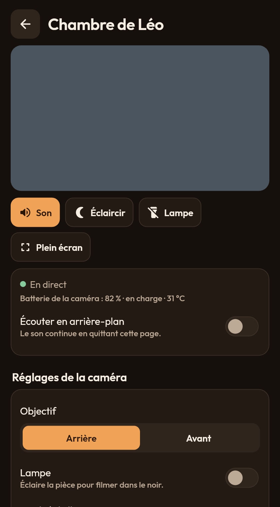
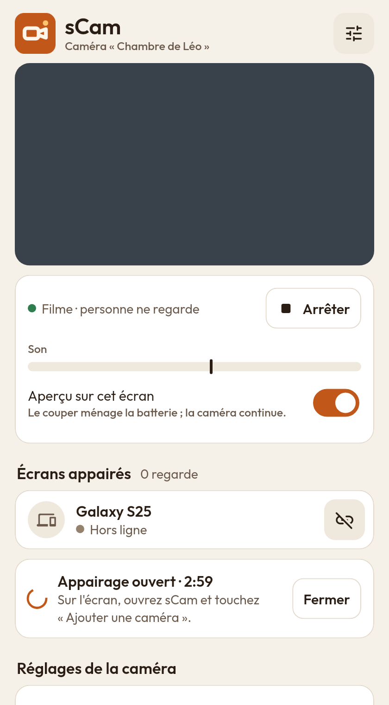

<h1 align="center">sCam</h1>

<b>Un téléphone Android (ou un PC) devient caméra de surveillance ou babyphone, chez vous, sur votre Wi-Fi.</b>

  
  
  

Le téléphone que vous n'utilisez plus dort dans un tiroir ? Posez-le dans la chambre du
bébé ou face à la porte d'entrée, branchez-le, et regardez la pièce depuis votre téléphone
ou votre PC : l'image et le son en direct, et une alerte quand bébé pleure ou que quelque
chose bouge. Pas de compte, pas d'abonnement, et rien ne sort de la maison.

  
  
  

## Pourquoi sCam

- **Une seconde vie pour un vieux téléphone.** Il a déjà une caméra, un micro, une lampe, du
  Wi-Fi et une batterie de secours : c'est un babyphone tout trouvé.
- **Chez vous, et seulement chez vous.** sCam ne fonctionne que sur le réseau de la maison :
  aucun serveur, aucun nuage, l'image ne passe jamais par Internet.
- **Seuls vos appareils regardent.** Chaque écran est appairé à la caméra avec un code à
  vérifier des deux côtés, et tout ce qui circule est chiffré.

## Ce que fait sCam

### 🎥 L'image et le son en direct
Touchez une caméra : l'image et le son arrivent avec très peu de retard (WebRTC, de
l'appareil à l'appareil). Coupez le son d'un geste, passez en plein écran.

### 👶 Babyphone
Activez « Écouter en arrière-plan » : sur Android, le son continue quand vous quittez sCam
ou que l'écran s'éteint, comme un babyphone.

### 🔔 Alerte bruit et alerte mouvement
La caméra écoute et regarde en continu. Un bruit qui dure (des pleurs, une voix), ou un
mouvement dans l'image, et tous vos écrans reçoivent une alerte, même quand sCam est en
arrière-plan sur le téléphone. Le seuil du bruit et la sensibilité au mouvement se règlent
avec un niveau en direct sous les yeux ; une porte qui claque seule ne déclenche rien.

### 🎞️ Extraits vidéo à chaque alerte
Quand une alerte se déclenche, la caméra Android enregistre les 30 secondes qui suivent,
image et son. Depuis votre écran, vous voyez la liste des extraits, vous les téléchargez
(dans la galerie du téléphone, ou le dossier Vidéos du PC), vous les regardez et vous les
effacez. Ils restent chez vous : sur la caméra, puis sur l'écran qui les télécharge.

### 🔦 Lampe, objectif et nuit
Allumez la lampe du téléphone caméra à distance, passez de l'objectif arrière à l'objectif
avant, et éclaircissez l'image sur votre écran quand la pièce est sombre.

### 🔋 La caméra veille, écran éteint
Le téléphone caméra continue écran éteint, et vous voyez à distance sa batterie et sa
température (et s'il chauffe).

### 🏠 Plusieurs caméras nommées
« Chambre de Léo », « Entrée » : appairez autant de caméras que vous voulez, et regardez-les
depuis votre téléphone, une tablette ou le PC Windows.

### 💻 Le PC peut aussi filmer
Pas de téléphone libre ? La webcam et le micro d'un PC Windows font une caméra sCam, avec les
mêmes alertes. Le PC ne se met pas en veille tant qu'il filme.

### 📺 Prêt pour sDash et Home Assistant
Sur demande, la caméra peut aussi offrir un flux MJPEG local, protégé par mot de passe, que
sDash ou Home Assistant savent afficher. Il est désactivé par défaut (voir la
[foire aux questions](#questions-fréquentes)).

### 🌗 Clair ou sombre
Comme toute la famille sPack, sCam suit le thème de l'appareil, ou celui que vous choisissez.

## Prise en main

1. **Installez sCam** sur l'appareil qui servira de caméra (téléphone Android 7 ou plus
   récent, ou PC Windows avec webcam) et sur celui qui regardera (téléphone Android ou PC
   Windows), connectés au même Wi-Fi.
2. **Choisissez un rôle** : « Caméra » sur l'appareil posé dans la pièce (donnez-lui un
   nom), « Écran » sur l'autre.
3. **Appairez-les** : sur la caméra, touchez « Appairer un écran » ; sur l'écran, « Ajouter
   une caméra ». Vérifiez que le même code à six chiffres s'affiche des deux côtés, et
   confirmez. C'est tout.

Le guide complet est dans [docs/GUIDE.md](docs/GUIDE.md).

## Questions fréquentes

**Est-ce que je peux regarder depuis l'extérieur de la maison ?**
Non, et c'est voulu : sCam ne fonctionne que sur le réseau local, rien ne passe par Internet.

**Qui peut voir l'image ?**
Seuls les écrans appairés, après vérification du code sur les deux appareils. L'image et le
son sont chiffrés. Un appareil non appairé est refusé avant d'avoir rien vu.

**Le téléphone caméra doit-il rester allumé ?**
L'écran peut s'éteindre, mais sCam doit rester ouvert (ne le fermez pas depuis les applis
récentes). Laissez le téléphone branché, et autorisez sCam à ignorer l'économie de batterie
(bouton dans les réglages ; chez Samsung, « Batterie → Non restreinte »).

**Le PC peut-il servir de caméra ?**
Oui, avec sa webcam et son micro. Il n'a ni lampe, ni objectif avant et arrière, et il
n'enregistre pas d'extraits (c'est réservé aux caméras Android). Laissez sCam ouvert : la
fenêtre peut être réduite.

**Et le flux MJPEG pour sDash ou Home Assistant ?**
Activez-le dans les réglages de la caméra : sCam affiche l'adresse, l'utilisateur et le mot
de passe à recopier. Attention : ce flux-là n'est **pas chiffré** (seulement protégé par mot
de passe), et il ne transporte que l'image. C'est pourquoi il est désactivé par défaut.

**sCam enregistre-t-il des vidéos ?**
Seulement à chaque alerte, et si l'option est activée sur la caméra : les 30 secondes qui
suivent l'alerte, gardées sur la caméra (les 30 derniers extraits). Le direct, lui, n'est
jamais enregistré. Les secondes *avant* l'alerte ne sont pas dans l'extrait.

## La famille sPack

sCam fait partie de **sPack**, une famille d'applications pratiques pour la maison, toutes
dans le même style.

| | | | |
| :---: | :---: | :---: | :---: |
|  |  |  |  |
| **[sDash](https://github.com/ShinezeoGame/sDash)** Toute la maison sur une tablette | **[sPhone](https://github.com/ShinezeoGame/sPhone)** L'écran du téléphone sur le PC | **[sDrop](https://github.com/ShinezeoGame/sDrop)** Fichiers et textes entre téléphone et PC | **[sPing](https://github.com/ShinezeoGame/sPing)** Les notifications du téléphone sur le PC |
|  |  |  |   |
| **[sWatt](https://github.com/ShinezeoGame/sWatt)** La consommation électrique de la maison bientôt | **sCam** Un vieux téléphone en caméra ou babyphone bientôt | **[sBackup](https://github.com/ShinezeoGame/sBackup)** Les photos du téléphone sauvegardées sur le NAS bientôt |   |

---

Fonctionnement, développement et logo : voir [docs/DEVELOPPEMENT.md](docs/DEVELOPPEMENT.md).
Police [Outfit](https://github.com/Outfitio/Outfit-Fonts) sous licence SIL Open Font License 1.1.
