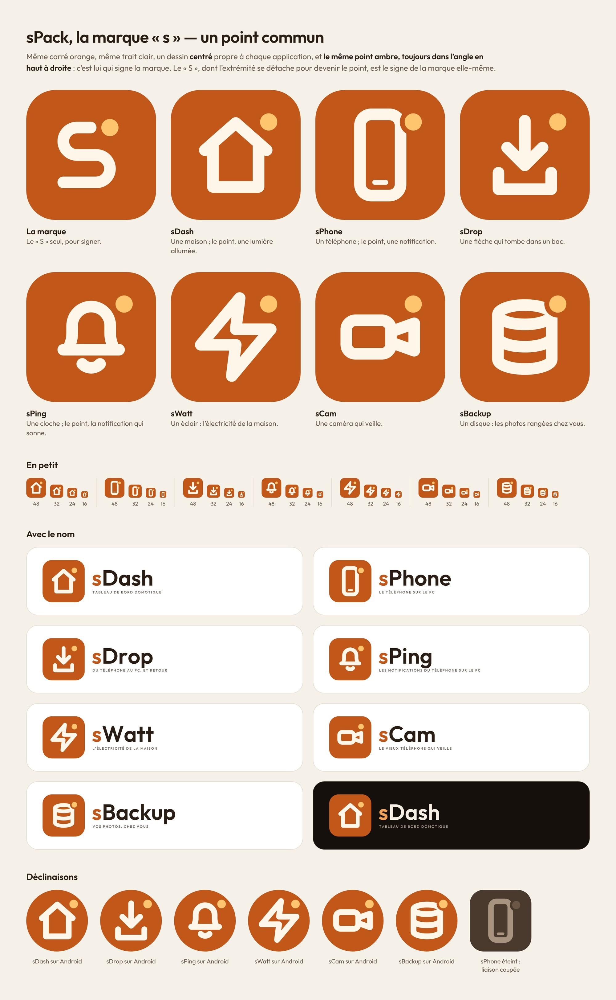

[← Retour à la présentation](../README.md)

# sCam : fonctionnement et développement

## Comment ça marche

sCam est une application [Flutter](https://flutter.dev), avec le même code pour Android et
Windows, chacun pouvant être caméra ou écran.

- **Découverte** : la caméra annonce son nom toutes les quatre secondes par un petit message
  UDP (multidiffusion et diffusion, port 47880). Un écran qui démarre envoie une « sonde » à
  laquelle les caméras répondent aussitôt. L'écran retient la dernière adresse de chaque
  caméra appairée, et s'y reconnecte même si les annonces ne passent pas.
- **Appairage** (`lib/data/net/pairing.dart`, `lib/core/crypto.dart`) : l'écran s'engage sur
  sa clé X25519 (empreinte SHA-256) avant de recevoir celle de la caméra, puis la révèle ;
  les deux appareils tirent la même clé d'appairage (HKDF) et le même code à six chiffres.
  L'appairage n'est accepté par la caméra que pendant les trois minutes où il est ouvert.
- **Connexion** : l'écran se relie en permanence (TCP, port 47880) à chaque caméra appairée.
  Chacun prouve qu'il connaît la clé d'appairage (HMAC sur deux nombres aléatoires), puis
  tous les messages sont chiffrés en AES-256-GCM avec une clé de session, un compteur par
  sens (message rejoué ou altéré : liaison coupée). Cette liaison porte l'état de la caméra
  (batterie, température, niveaux), les alertes, les réglages et la signalisation WebRTC.
- **Image et son** : WebRTC (`flutter_webrtc`), la caméra fait l'offre. Aucun serveur STUN
  ou TURN, et seuls les candidats d'adresse locale sont acceptés (`isLocalCandidate`) : la
  transmission ne peut pas sortir de la maison. Les empreintes DTLS voyagent dans la liaison
  chiffrée, ce qui authentifie aussi le flux.
- **Mesures et alertes** : sur Android, `CameraAnalyzer.kt` lit les images et le son que
  WebRTC transmet déjà (processeur d'images et récepteur audio de `flutter_webrtc`) : niveau
  sonore, part de l'image qui change sur une grille de 64 × 48, et JPEG pour le flux MJPEG.
  Pour que le micro reste ouvert quand personne ne regarde, la caméra garde une liaison
  WebRTC interne vers elle-même (son coupé). `lib/core/detection.dart` décide des alertes.
- **Webcam du PC** (`lib/core/motion.dart`) : sous Windows, le niveau sonore vient des
  statistiques WebRTC de la liaison interne (`media-source`, `audioLevel`), et le mouvement
  d'une image capturée chaque seconde (`captureFrame`, PNG) réduite à la même grille, dans un
  isolat. Le changement global de luminosité retiré est la médiane des écarts, comme sur
  Android. Le PC ne se met pas en veille pendant qu'il filme (`SetThreadExecutionState`).
- **Extraits** : à chaque alerte, une caméra Android enregistre 30 s (`MediaRecorder` de
  `flutter_webrtc`, MP4) dans son espace privé, et garde les 30 derniers. Les écrans
  reçoivent la liste (`extraits`), téléchargent par morceaux de 96 Ko demandés un à un
  (`morceau`, dans la liaison chiffrée) et peuvent effacer (`supprimerExtrait`). La caméra
  ne sert que les fichiers de sa liste, dont le nom suit un format strict.
- **Arrière-plan** : `ScamService.kt`, service au premier plan (caméra + micro pour la
  caméra ; appareil connecté + lecture pour l'écran), avec verrous de veille et Wi-Fi.
- **MJPEG** (`lib/data/net/mjpeg_server.dart`) : port 47881, désactivé par défaut, mot de
  passe (« Basic » ou `?mdp=`), adresses locales seulement, non chiffré.

## Développement

Flutter 3.47. Pour Windows, Visual Studio avec la charge « Développement Desktop en C++ » ;
pour Android, le SDK Android.

```powershell
flutter run -d windows
```

- Vérifications : `dart format -l 120 lib test`, `flutter analyze` et `flutter test`.
  `test/core_test.dart` fait dialoguer une vraie caméra et un vrai écran sCam sur la machine
  (découverte, appairage, code refusé, intrus, alertes, extraits, signalisation, réglages,
  MJPEG), avec
  une caméra et un WebRTC simulés (`test/support/harness.dart`). `test/app_test.dart`
  parcourt l'interface à trois tailles de fenêtre, en clair et en sombre.
- Captures de la documentation : `SCAM_CAPTURES=1 flutter test test/captures_test.dart`.
- `.github/workflows/build.yml` teste, compile l'APK et l'application Windows, lance
  celle-ci pour de bon (elle prépare une offre WebRTC et l'écrit dans un compte rendu,
  variable `SCAM_ESSAI`), crée l'installateur, et publie la version à chaque envoi sur
  `main` ou à la demande (« Run workflow », case « Publier »). Un changement qui ne touche que
  la documentation ne déclenche rien.
- Clé de signature Android (facultative) : secrets `ANDROID_KEYSTORE_BASE64` et
  `ANDROID_KEYSTORE_PASSWORD` du dépôt, comme pour sDash et sDrop.

## Logo

sCam partage sa marque avec les autres applications sPack : le même carré orange, le même
trait clair, et le même point ambre, toujours au même endroit. Seul le dessin change — ici
une caméra vidéo.



`tools/logo/generer_logo.py` (identique dans tous les dépôts sPack, seule `APPLI_DU_DEPOT`
diffère) produit les SVG de `docs/logo/` ; `tools/logo/exporter.py` en tire les PNG et les
icônes Windows et Android. Les icônes de la famille sont dans `docs/logo/famille/`.

## Licences

Police [Outfit](https://github.com/Outfitio/Outfit-Fonts) sous licence SIL Open Font License 1.1
(`assets/fonts/OFL.txt`).
